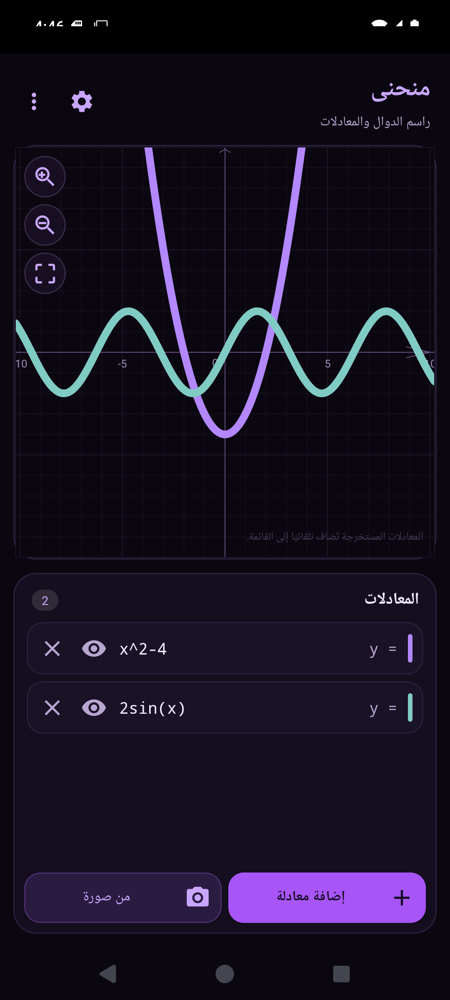
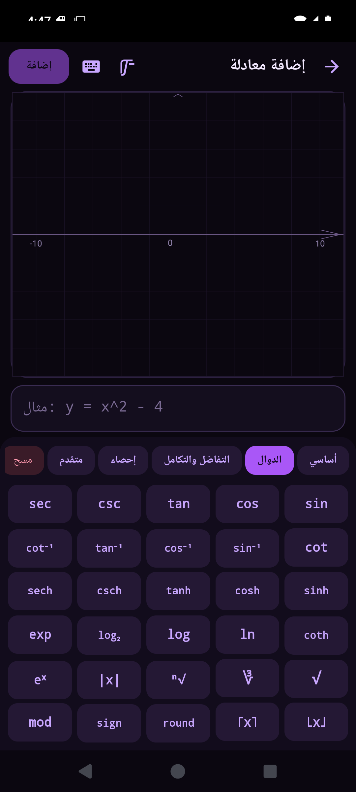

# Munhana — Arabic Graphing Calculator

Munhana is an Android graphing calculator with an Arabic (RTL) interface and a
dark purple theme. **Built with AI.**

- Plot functions, implicit equations and inequalities.
- Full-screen equation editor with live graph preview.
- Equation editor with a live written-form preview and a calculator-style
  keyboard: template column, symbol column, number pad and operator column,
  plus function, trigonometry, calculus, symbols and variable tabs.
- Everything is written as maths, never as code: `√`, `∛`, `π`, `x²`, `x₁`,
  `≤`, `≥`, `|x|`, `⌊x⌋`; function keys insert symbols directly.
- Auto-fit: the graph frames all curves whenever the equation list changes;
  pan and zoom stay fully manual afterwards.
- Graph settings: grid, axis labels, arrows, X/Y axes, inequality shading
  (off by default), auto-fit, degrees/radians and a custom window.
- Import a photo and read equations offline, then correct them manually.
  Cropping is manual, and the handwriting reader groups lines automatically.
- Export the graph as PNG with the equations written under it, export as TXT,
  and share a `.munhana` project that opens directly in Munhana.
- Works fully offline and needs no storage permission.




**Requirements:** Android 7.0 (API 24) or newer, `arm64-v8a` or `armeabi-v7a`.

**Download:** [download page](https://zain-wz.github.io/munhana/) or
[Releases](https://github.com/ZAIN-WZ/munhana/releases). The latest version is `1.2`.

GitHub release downloads redirect to a host that is sometimes blocked in Syria.
These mirrors serve the same APK without a VPN:

| Version | jsDelivr (no VPN) | Statically | GitHub Pages |
| --- | --- | --- | --- |
| 1.2 | [munhana-1.2.apk](https://cdn.jsdelivr.net/gh/ZAIN-WZ/munhana@main/release-assets/munhana-1.2.apk) | [mirror](https://cdn.statically.io/gh/ZAIN-WZ/munhana/main/release-assets/munhana-1.2.apk) | [mirror](https://zain-wz.github.io/munhana/release-assets/munhana-1.2.apk) |
| 1.1 | [munhana-1.1.apk](https://cdn.jsdelivr.net/gh/ZAIN-WZ/munhana@v1.1/release-assets/munhana-1.1.apk) | [mirror](https://cdn.statically.io/gh/ZAIN-WZ/munhana/v1.1/release-assets/munhana-1.1.apk) | [mirror](https://zain-wz.github.io/munhana/release-assets/munhana-1.1.apk) |
| 1.0 | [munhana-1.0.apk](https://cdn.jsdelivr.net/gh/ZAIN-WZ/munhana@v1.0/release-assets/munhana-1.0.apk) | [mirror](https://cdn.statically.io/gh/ZAIN-WZ/munhana/v1.0/release-assets/munhana-1.0.apk) | [mirror](https://zain-wz.github.io/munhana/release-assets/munhana-1.0.apk) |

**Build from source:**

```bash
export ANDROID_HOME=/path/to/android-sdk   # platform 35 + build-tools 35.0.0
bash build.sh                               # output: dist/munhana-1.2.apk
```

The build script creates a local development key if none is provided.

**License:** [MIT](LICENSE).

---

# منحنى — راسم دوال عربي

منحنى تطبيق أندرويد لرسم الدوال والمعادلات، بواجهة عربية (RTL) وثيم داكن
بنفسجي. **صُنع بالذكاء الاصطناعي.**

- رسم الدوال والمعادلات الضمنية والمتباينات.
- محرّر معادلات بشاشة كاملة مع معاينة حيّة للرسم.
- محرّر بمعاينة حيّة ولوحة مفاتيح على نمط الآلة الحاسبة: عمود قوالب، عمود
  رموز، لوحة أرقام، عمود عمليات، وتبويبات للدوال والمثلثات والتفاضل والرموز
  والمتغيرات.
- كل شيء يُكتب رياضيات لا شيفرة: `√`، `∛`، `π`، `x²`، `x₁`، `≤`، `≥`،
  `|x|`، `⌊x⌋`؛ ومفاتيح الدوال تُدرج الرموز مباشرة.
- ملاءمة تلقائية: يُضبط العرض ليُظهر كل المنحنيات عند أي تغيير في المعادلات،
  مع بقاء التكبير والتحريك بيدك.
- إعدادات الرسم: الشبكة، أرقام المحاور، الأسهم، محورا X/Y، تظليل المتباينات
  (معطّل افتراضيًا)، الملاءمة التلقائية، درجات/راديان، ومدى عرض مخصّص.
- قراءة المعادلات من صورة دون اتصال، مع إمكانية التصحيح اليدوي.
  القص يدوي، وقارئ الكتابة اليدوية يجمع الأسطر تلقائيًا.
- تصدير الرسم PNG مع كتابة المعادلات أسفله، وتصدير TXT، ومشاركة ملف
  `.munhana` يُفتح مباشرة في منحنى.
- يعمل دون إنترنت ولا يحتاج صلاحية تخزين.

**المتطلبات:** أندرويد 7.0 (API 24) أو أحدث، ومعمارية `arm64-v8a` أو
`armeabi-v7a`.

**التحميل:** [صفحة التحميل](https://zain-wz.github.io/munhana/) أو
[Releases](https://github.com/ZAIN-WZ/munhana/releases). أحدث إصدار هو `1.2`.

تنبيه: تحميل إصدارات GitHub يُحوَّل إلى خادم قد يكون محجوبًا في سوريا.
الروابط التالية تعطي نفس الملف بدون VPN:

| الإصدار | jsDelivr (بدون VPN) | Statically | GitHub Pages |
| --- | --- | --- | --- |
| 1.2 | [munhana-1.2.apk](https://cdn.jsdelivr.net/gh/ZAIN-WZ/munhana@main/release-assets/munhana-1.2.apk) | [بديل](https://cdn.statically.io/gh/ZAIN-WZ/munhana/main/release-assets/munhana-1.2.apk) | [بديل](https://zain-wz.github.io/munhana/release-assets/munhana-1.2.apk) |
| 1.1 | [munhana-1.1.apk](https://cdn.jsdelivr.net/gh/ZAIN-WZ/munhana@v1.1/release-assets/munhana-1.1.apk) | [بديل](https://cdn.statically.io/gh/ZAIN-WZ/munhana/v1.1/release-assets/munhana-1.1.apk) | [بديل](https://zain-wz.github.io/munhana/release-assets/munhana-1.1.apk) |
| 1.0 | [munhana-1.0.apk](https://cdn.jsdelivr.net/gh/ZAIN-WZ/munhana@v1.0/release-assets/munhana-1.0.apk) | [بديل](https://cdn.statically.io/gh/ZAIN-WZ/munhana/v1.0/release-assets/munhana-1.0.apk) | [بديل](https://zain-wz.github.io/munhana/release-assets/munhana-1.0.apk) |

**البناء من المصدر:**

```bash
export ANDROID_HOME=/path/to/android-sdk   # platform 35 + build-tools 35.0.0
bash build.sh                               # الناتج: dist/munhana-1.2.apk
```

ينشئ سكربت البناء مفتاح تطوير محليًا إن لم يوجد مفتاح.

**الترخيص:** [MIT](LICENSE).
